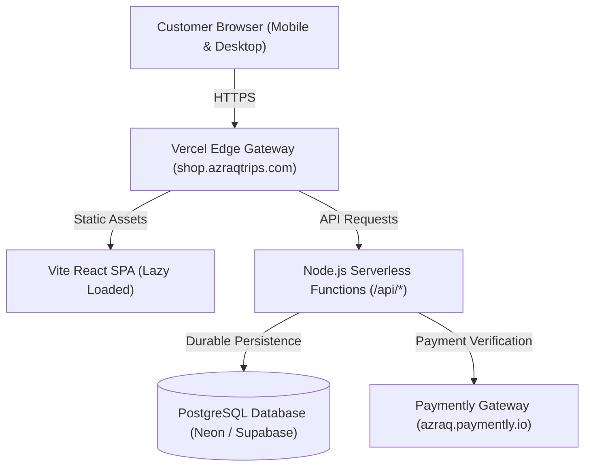

# AZRAQ — Curated Everyday Goods

> **Tagline:** *Discover better. Live better.*  
> **Descriptor:** CURATED EVERYDAY GOODS  
> **Market:** Bangladesh  
> **Currency:** BDT (৳)  
> **Production Store:** [https://shop.azraqtrips.com](https://shop.azraqtrips.com)  
> **Vercel Mirror:** [https://azraqshop.vercel.app](https://azraqshop.vercel.app)  
> **Repository:** [https://github.com/istihadahmed007/Azraq-Shop](https://github.com/istihadahmed007/Azraq-Shop)  

---

## 🌟 Architecture & Hosting Topology

AZRAQ operates on a **Unified Single-Platform Hosting Architecture**:

* **Primary Production Host (Vercel):** Serves the high-performance Vite React SPA alongside Node.js serverless API functions (`/api/payments/*`, `/api/orders/*`, `/api/admin/*`, `/api/search-by-image`) on the exact same domain (`shop.azraqtrips.com`).
* **Relational Persistence (PostgreSQL):** Stores checkout attempts, confirmed customer orders, payment transaction logs, and append-only status audit histories (`order_status_history`). Fails closed in production if `DATABASE_URL` is omitted.
* **Continuous Integration (GitHub Actions):** Executes all 60 unit, security, localization, and audit test suites and compiles the production bundle on every push and pull request.



---

## 🔒 Security & Payment Safety Invariants

1. **Server-Side Administrative Authentication:**
   * Every administrative endpoint (`/api/orders`, `/api/payments/transactions`, `/api/payments/refund`, `/api/orders/update-status`) requires a valid `x-admin-key` or `Authorization: Bearer <key>` header.
   * Compares secrets using constant-time `crypto.timingSafeEqual` to prevent timing attacks.
   * **Fail-Closed in Production:** If `ADMIN_API_KEY` is missing or shorter than 8 characters, administrative endpoints reject all incoming requests with HTTP 500.

2. **Durable Database Persistence:**
   * In production (`NODE_ENV=production`), `DATABASE_URL` is strictly required. Persistent write operations (order creation, webhook logs, refunds) reject execution rather than silently dropping data into ephemeral serverless memory.

3. **Ownership-Verified Order Tracking:**
   * Guessable Order IDs alone are never sufficient for authorization.
   * Customers must supply both their Order ID and either their normalized 11-digit mobile number (`018...`) or cryptographically unguessable tracking token (`trk_...`).
   * Responses mask customer names and phone numbers to eliminate PII harvesting.

4. **Payment Authoritativeness & Idempotency:**
   * All prices, delivery fees (Inside Dhaka ৳70 / Outside Dhaka ৳130 / Free >= ৳3,000), and promo discounts are calculated server-side.
   * Orders are only marked `PAID` after authentic provider verification.
   * Repeated webhook and verification calls are processed idempotently.

---

## ⚡ Loading Performance & Storage Resiliency

* **Initial JS Bundle Reduction (>96%):** The initial entry bundle was reduced from **3.58 MB down to 125 kB** (29 kB gzip) by:
  * Extracting the 4.16 MB catalog from the synchronously bundled module graph. An ultra-slim initial catalog (13 kB) renders above-the-fold content instantly, followed by asynchronous hydration of the full catalog.
  * Lazy-loading non-critical overlays (`CheckoutModal`, `OrderTrackingModal`, `AdminPanel`, `VisualSearchModal`, `ProductDetailModal`).
* **Resilient Browser Storage:**
  * Uses a safe storage utility (`src/utils/storage.js`) with versioning, runtime schema validation, and graceful quota-exceeded handling to prevent mobile browser crashes.
  * The master catalog is never written to `localStorage`.

---

## ⚙️ Production Environment Variables

Configure these variables in your Vercel Project Settings (**Settings → Environment Variables**):

| Variable Name | Environment | Required | Description |
| :--- | :---: | :---: | :--- |
| `NODE_ENV` | Production | Yes | Set to `production` to activate strict fail-closed security. |
| `ADMIN_API_KEY` | Production | Yes | Strong secret token for administrative APIs (min 16 chars). |
| `DATABASE_URL` | Production | Yes | PostgreSQL connection string with SSL (`sslmode=require`). |
| `PAYMENTLY_API_KEY` | Production | Yes | Merchant API key from your Paymently portal. |
| `PAYMENTLY_BASE_URL` | Production | Yes | Default: `https://azraq.paymently.io` |
| `APP_BASE_URL` | Production | Yes | Public URL (e.g. `https://shop.azraqtrips.com`). |

---

## 🧪 Automated Testing & Verification

Run all test suites locally:

```bash
# Run all 60 audit, security, and storefront tests
npm test

# Run individual test suites
npm run test:payment     # Paymently gateway & verification tests (14 tests)
npm run test:storefront  # Delivery, catalog, and engine tests (10 tests)
npm run test:tracking    # Customer order tracking & authorization (14 tests)
npm run test:locale      # Bengali translation & BDT currency tests (11 tests)
npm run test:security    # Admin auth, durability & storage tests (11 tests)

# Run deployment API smoke tests
npm run smoke:api
```

---

## 💻 Local Development

```bash
# Clone the repository
git clone https://github.com/istihadahmed007/Azraq-Shop.git
cd Azraq-Shop

# Install dependencies
npm install

# Start local full-stack dev server (with API middleware)
npm run dev

# Build production bundle
npm run build
```

---

## 📄 License

MIT © [AZRAQ](https://github.com/istihadahmed007/Azraq-Shop)
