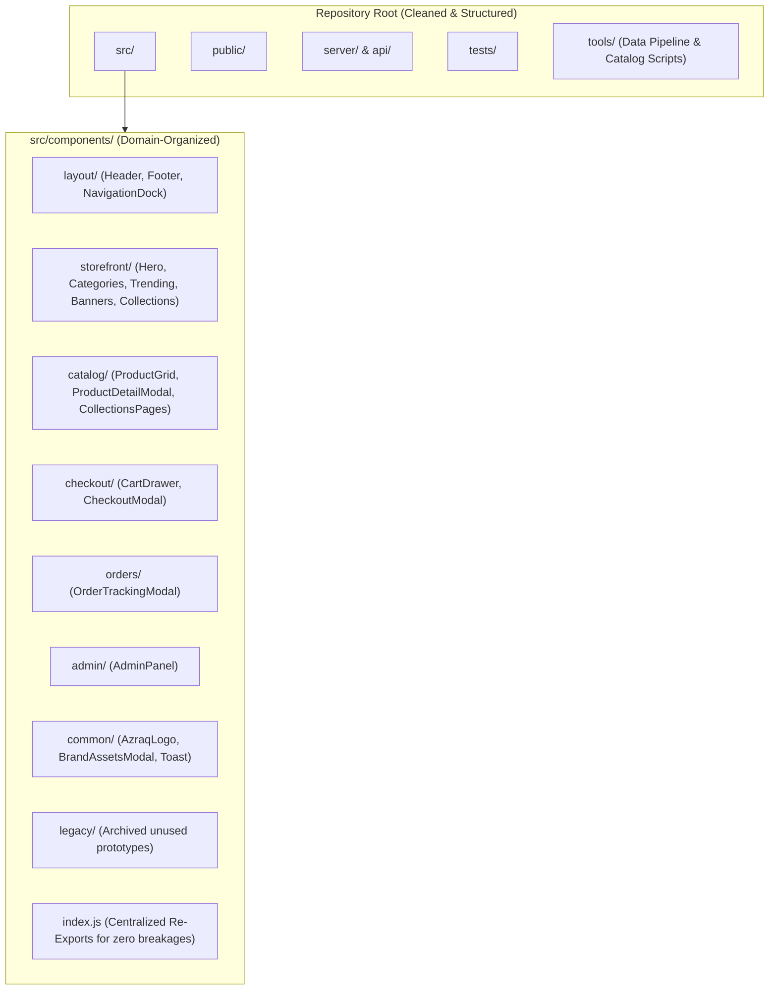

# AZRAQ Shop — Codebase Organization & Optimization Plan

## 1. Executive Summary & Baseline Status

- **Repository:** `istihadahmed007/Azraq-Shop`
- **Architecture:** React 18 + Vite SPA, Node.js API endpoints (`/api/*`), Tailwind CSS, PostgreSQL relational persistence.
- **Baseline Test Suite Status:** **70/70 tests passing (100%)** across payment verification, storefront audit, order tracking, security/durability, and Bengali/BDT localization.
- **Baseline Build Status:** Production build compiles cleanly in **11.67s** via Vite with chunk splitting.

---

## 2. Key Deficiencies Identified

### A. Runtime Crash: Missing `activeCategory` in `ShopContext`
- **Location:** `src/components/ProductGrid.jsx` (L12) & `src/context/ShopContext.jsx`
- **Issue:** `ProductGrid` destructures `activeCategory` and `setActiveCategory` from `useShop()`, but neither exists in `ShopContext.jsx`.
- **Impact:** Clicking any category button in `ProductGrid` triggers `TypeError: setActiveCategory is not a function`, breaking client-side category filtering on the catalog page.

### B. Broken Header & Hero Anchor Navigation
- **Location:** `src/components/Header.jsx` (L282) & `src/components/HeroSection.jsx` (L103)
- **Issue:** The "Deals" button in `Header.jsx` and "Top Offers & Deals" in `HeroSection.jsx` both query `document.getElementById('popular-products')`. However, the active deals section is `TrendingRightNowSection.jsx`, which only has `id="trending-now"`.
- **Impact:** Clicking "Deals" or "Top Offers" fails silently with no scroll action.

### C. 7 Orphaned / Dead Section Components in `src/components/`
- **Evidence:** `git grep` confirms these 7 files are never imported anywhere in `src/`, `tests/`, or `server/`:
  1. `src/components/BestPicksSection.jsx`
  2. `src/components/DarkFeatureBar.jsx`
  3. `src/components/EditorialSection.jsx`
  4. `src/components/FeaturedCollectionsCarousel.jsx`
  5. `src/components/NewArrivalsSection.jsx`
  6. `src/components/ProductCarouselSection.jsx`
  7. `src/components/TrendingDiscoveriesSection.jsx`
- **Impact:** Flat directory with 32 components mixed together, creating confusion between active sections and obsolete prototypes.

### D. 34 MB of Staging Scrapes and Build Artifacts at Repository Root
- **Evidence:** The repository root contains large loose JSON dumps and extraction scripts:
  - `all_categories_products_raw.json` (6.2 MB)
  - `azraq_products.json` (7.6 MB)
  - `category_5_products.json` (3.9 MB)
  - `easydrop_complete_catalog_raw.json` (7.6 MB)
  - `all_latest_products_raw.json` (3.9 MB)
  - `CategoryProducts_chunk.js` (3.7 MB)
  - `build_full_catalog.py` (3.8 KB)
  - `azraq-shop-dist.zip` (1.3 MB)
- **Impact:** Pollutes the root workspace; completely unneeded for runtime execution since the app reads from `src/data/` and `public/data/`.

### E. Hardcoded Label vs Dynamic Catalog in `ProductGrid`
- **Location:** `src/components/ProductGrid.jsx` (L122)
- **Issue:** Category pill hardcodes `All (1,206)` even though `products.length` starts at 8 and hydrates to 257 products.
- **Impact:** Discrepancy between the pill label and the adjacent product count.

---

## 3. Targeted Reorganization & Optimization Plan

### Planned Actions:
1. **Fix `ShopContext.jsx` Runtime Filter Bug:**
   - Add `activeCategory` state (default `'All'`) and `setActiveCategory` to `ShopContext`.
   - Update `ProductGrid.jsx` to dynamically render `All (${products.length})` without hardcoded counts.
2. **Fix Navigation Scroll Anchors:**
   - Add `id="popular-products"` alongside `id="trending-now"` in `TrendingRightNowSection.jsx` so "Deals" and "Top Offers" scroll smoothly.
   - Update `NavigationDock.jsx` wishlist action to scroll directly to the product catalog.
3. **Organize `src/components/` by Domain Feature:**
   - Move active components into feature folders: `layout/`, `storefront/`, `catalog/`, `checkout/`, `orders/`, `admin/`, `common/`.
   - Move the 7 orphaned files into `src/components/legacy/`.
   - Create a clean `src/components/index.js` barrel file and maintain root compatibility stubs so existing import paths continue working without disruption.
4. **Organize Staging Data Scrapes:**
   - Move raw pipeline files (`easydrop_complete_catalog_raw.json`, `build_full_catalog.py`, etc.) into `tools/catalog-pipeline/`.
   - Ensure `public/data/` and `src/data/` remain strictly in place.
5. **Preserve All Safety Invariants:**
   - Zero changes to payment gateways, order persistence, verification APIs, and database logic.
   - All 70 existing tests and Vite build must remain passing.
